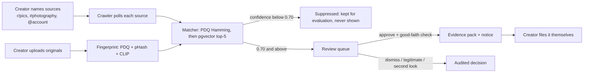

# Repost Radar

Find where a creator's images have been re-uploaded on Bluesky (and Reddit, with API access), even cropped, filtered, re-encoded or screenshotted. Review each match side by side and export a DMCA-ready evidence pack. A human approves every match; nothing is ever sent to a platform automatically.


<sub>Recorded against the mock API by the <b>Demo GIF</b> workflow (`apps/web/scripts/recordDemo.mjs`); sample images are generated.</sub>

> **Status:** v1 feature-complete (phases 0–4) with phase 5 polish under way. Every phase gate runs in CI against the real Docker stack. See [docs/BUILD_TASKS.md](docs/BUILD_TASKS.md).

## How it works



1. **Register originals.** Each image gets three fingerprints: PDQ (Meta's 256-bit perceptual hash), pHash, and a 512-d CLIP embedding.
2. **Watch sources you name.** Subreddits, Bluesky hashtags or accounts. Only places you name are crawled; there are no site-wide sweeps.
3. **Match.** Every new image post is fingerprinted and compared with your bank: a cheap Hamming distance on PDQ first, then a pgvector cosine search. One documented confidence score, with both raw signals stored beside it.
4. **Review.** Pending matches arrive sorted by confidence. Approve, dismiss, mark as legitimate reuse, or send for a second look, with keyboard shortcuts and a note on each decision.
5. **Export.** Approving builds a ZIP containing both images, a side-by-side PNG, `metadata.json` with hashes and the decision log, a PDF summary, and a notice with every placeholder resolved.

## Results

Measured on 200 CC0 originals × 8 reposter edits (1,600 copies) against 2,000 same-theme CC0 photos, so the negatives are a different beach for a beach, not random noise. The 0.70 threshold was picked on one half of the originals and measured on the other, unseen half:

| | Precision | Recall |
| --- | --- | --- |
| Held-out half | **0.962** | **0.966** |
| Full set | 0.964 | 0.963 |

| Edit | resize 50% | JPEG q40 | warm filter | screenshot | flip | rotate 10° | crop 20% | meme caption |
| --- | --- | --- | --- | --- | --- | --- | --- | --- |
| Recall (held-out) | 1.00 | 1.00 | 1.00 | 1.00 | 1.00 | 0.98 | 0.91 | 0.84 |

The first guess at the threshold (0.80) had perfect precision but found only 60% of copies. Three alternative scoring rules were compared, and none beat the simple one by more than a recall point. Method, every run and known limits: [docs/notes/phase3-tuning.md](docs/notes/phase3-tuning.md). Reproduce with `make eval` ([eval/README.md](eval/README.md)).

## Features

- **Review UI**: queue with Pending / Second look / Decided tabs, side-by-side compare view, shortcuts A / D / L / E, and an approve dialog with the §512(f) warning and a required good-faith checkbox.
- **Evidence packs and notices**: per-platform templates with `{{placeholders}}`. A pack is never built while a placeholder is empty, and the page tells you what to fix.
- **Proof of ownership**: for each original, say where and when you first published it; the worker also reads the file's own "date taken", Artist and Copyright (EXIF). It shows next to every match, flags a file that names someone else, and goes into the PDF, `metadata.json` and the notice, always labelled by source and never as verified.
- **Platform adapters**: **Bluesky is the live platform** (public AppView, no account needed; a CI job finds a real post end to end and soaks for an hour). Account feeds always work; Bluesky's hashtag search can refuse cloud networks with a 403, and setting `BLUESKY_IDENTIFIER` / `BLUESKY_APP_PASSWORD` routes search through your own account. The Reddit adapter is complete but Reddit's Data API is approval-only and access was declined, so it runs against a local fixture feed. A new platform is one folder; see [docs/ADDING_A_PLATFORM.md](docs/ADDING_A_PLATFORM.md).
- **Browser extension**: right-click an image to check it against your originals; the popup copies approved notices for filing. See [apps/extension](apps/extension/README.md).
- **Respects takedowns**: posts behind open matches are re-checked; a copy that is gone closes as `removed` and its stored image is deleted.
- **Reliable by construction**: jobs carry ids only, use deterministic job ids and unique keys, and are retried with backoff. CI kills the worker mid-flow and restarts the API, and nothing is lost.
- **Private by default**: single admin sign-in (Argon2id, HTTP-only cookie), images served only behind the session, unmatched crawled images deleted after 7 days.

## Quick start

Needs Docker, Node 22+ with pnpm, and [uv](https://docs.astral.sh/uv/).

```bash
cp .env.example .env
pnpm install
docker compose up -d --build --wait postgres redis s3 api crawler fingerprint-worker fake-reddit
docker compose run --rm s3-init
pnpm run migrate
pnpm run seed        # registers 20 CC0 sample originals
docker compose up -d --build --wait web
```

Open **http://localhost:3000** and sign in as `admin` with `ADMIN_PASSWORD` from `.env`.

1. **Settings**: fill in your legal name, email and address (a notice must carry them).
2. **Originals**: drop in your images, or keep the 20 seeded samples.
3. **Sources**: add Bluesky hashtags or accounts to watch, e.g. `#photography` or `@someone.bsky.social`. Bluesky needs no account. Reddit subreddits run against the local fixture feed unless you have approved Reddit API credentials.
4. **Review**: matches appear as they are found.

To work on the UI without Docker: `pnpm --filter @repost-radar/web dev:mock` serves it against an in-memory mock API (password `change-me-local-only`).

`make live-bluesky` runs the live check: a real recent `#photography` post is registered as an original in your local stack, and the crawler, watching its author, must find it and queue it, followed by a soak on two active accounts (`SOAK_MINUTES`, default 60). Nothing is posted.

`make gate4` runs the end-to-end check CI runs. Planted copies land in the queue, get approved and produce an evidence pack, with the worker killed and the API restarted part-way through. A simulated takedown then closes the last match.

## Architecture

| Part | Tech | Role |
| --- | --- | --- |
| API | Fastify, TypeScript | Sign-in, uploads, sources, queue, decisions, packs; enqueues jobs |
| Review UI | React 19, Vite, Tailwind, TanStack Query | Served by nginx, which proxies `/api` so the session cookie stays same-origin |
| Crawler | TypeScript | Polls sources through platform adapters with per-platform rate budgets, stores images, enqueues matches, re-checks for takedowns |
| Worker | Python, open_clip, pdqhash, Pillow, fpdf2 | Fingerprints, matches, builds evidence packs |
| Stores | Postgres 16 + pgvector, Redis (BullMQ), SeaweedFS (S3) | |

Sequence diagrams, data model and trade-offs: [docs/ARCHITECTURE.md](docs/ARCHITECTURE.md).

## Other platforms

| Platform | Status |
| --- | --- |
| Bluesky | Live. Public AppView, free, no approval |
| Reddit | Adapter built and tested on fixtures. The Data API has been approval-only since Nov 2025; a request for this project was declined |
| X / Twitter | Possible: pay-per-use API (about $5 per 1,000 posts read), so watching busy hashtags gets expensive. Not built |
| Instagram / Facebook | Hashtag and page content need Meta App Review and business verification, for uses that don't include copyright monitoring. Not built; for Meta's platforms, [Rights Manager](https://rightsmanager.fb.com/) is the official matching tool |

Scraping any platform against its terms is out of scope.

## Non-goals

- **Sending notices.** No platform offers a clean API for it, and that is where the legal risk sits. Repost Radar stops at approve and export.
- **Deepfakes or likeness misuse.** It finds copies of specific images, not people.
- **Multi-tenant SaaS.** No billing, plans, team roles or email notifications.
- **Legal advice.** The draft notice is a starting point; the creator is responsible for what they file.

## Responsible use

Knowingly filing a false takedown notice can make you liable for damages (17 U.S.C. §512(f)). Approve only your own work, consider fair use, and use the "legitimate" action for licensed or permitted reuse so it never comes back. The crawler uses official APIs, identifies itself with a descriptive user agent, honours rate limits, and stores only post id, author handle, URL, timestamp and image.

## Docs

- [Product requirements](docs/PRD.md)
- [Architecture and sequence diagrams](docs/ARCHITECTURE.md)
- [Build tasks and phase gates](docs/BUILD_TASKS.md)
- [Adding a platform](docs/ADDING_A_PLATFORM.md)
- [Evaluation](eval/README.md) and [tuning log](docs/notes/phase3-tuning.md)
- [Testing by hand](docs/TESTING.md), including a one-click Codespace
- [Contributing](CONTRIBUTING.md)

## Licence

[MIT](LICENSE). The evaluation and seed images are CC0 from Wikimedia Commons; each one's source is recorded in `eval/manifest.json` and `eval/seed/SOURCES.md`.
