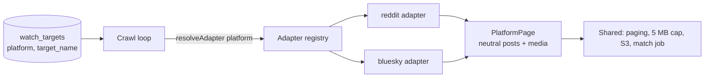

# Adding a platform

Repost Radar watches platforms through adapters. The crawl loop, paging rules, download cap, storage, matcher and review queue never import a platform directly; they ask a registry for "the adapter called `bluesky`" and work with platform-neutral posts. Adding a platform touches four places and needs no database migration. Two worked examples: `reddit` (OAuth, listing pages) and `bluesky` (public XRPC, cursor pages, optional session).



## 1. Declare it in `packages/platforms`

Create `packages/platforms/src/<name>.ts` exporting a `PlatformDefinition`, then add it to `PLATFORM_DEFINITION_LIST` in `registry.ts` and export it from `index.ts`.

| Field | Meaning | Reddit example |
| --- | --- | --- |
| `platformName` | Stored in `watch_targets.platform` / `crawled_posts.platform` | `reddit` |
| `displayName`, `targetLabel`, `targetExample` | Used in API messages and `GET /platforms` | `Reddit`, `subreddit`, `r/pics` |
| `maxRequestsPerMinute` | Budget the API enforces across a creator's targets on this platform | `50` |
| `normaliseTarget(raw)` | Canonical target or `undefined` if invalid | `"r/pics/"` → `"pics"` |
| `targetUrl(name)` | Public link to the target | `https://www.reddit.com/r/pics/` |

Add tests next to it in `registry.test.ts`. This package is pure: no network code.

## 2. Write the crawler adapter

Create `apps/crawler/src/platforms/<name>/` with:

- **`<name>Config.ts`**: reads its own `<NAME>_*` environment variables (base URL, credentials, user agent, requests per minute). Throw a clear error if a required credential is missing.
- **a client**: fetches one newest-first page for a target. Call `tokenBucket.take()` before every request, back off on 429/5xx with `computeBackoffMs`, and call `onRequest(statusCode)` so `/metrics` sees it.
- **a mapper**: turns the platform's response into `PlatformPageDetails`. Each `PlatformPostDetails` needs a stable `sourcePostId` (the paging cursor), `postedAt`, `permalinkUrl`, and a `mediaList` of downloadable images; each image's `platformPostId` must be unique within the platform. Text/video posts get an empty `mediaList`.
- **`<name>Adapter.ts`**: exports a `PlatformAdapterFactory` whose `createAdapter(env, deps)` builds the client with `deps.createTokenBucket(...)` and returns `{ platformName, userAgent, fetchNewPage }`.

Register the factory in `ADAPTER_FACTORY_LIST` in `apps/crawler/src/platforms/adapterRegistry.ts`. The registry fails at startup if a platform is enabled without an adapter, or has an adapter without a definition.

Unit-test the mapper with recorded responses, as `reddit/listing.test.ts` does.

## 3. Configure it

- Add `<NAME>_*` settings to `.env.example` and pass them to the crawler in `docker-compose.yml`.
- Enable it: `ENABLED_PLATFORMS=reddit,<name>` (read by both the API and the crawler).
- Optionally add an offline fixture mode like Reddit's `fake-reddit`, so CI can exercise it without credentials.

Smoke-test it against the real platform without the database:

```bash
pnpm --filter @repost-radar/crawler smoke <name> "<target>"
```

## 4. Use it

```bash
curl -X POST localhost:8080/watch-targets -H 'content-type: application/json' \
  -d '{"platform":"<name>","target":"<target>","pollIntervalSeconds":300}'
```

`GET /platforms` lists what is enabled. Crawl requests appear per platform under `crawlRequestsLastHourByPlatform` in `GET /metrics`.

## Checklist

- [ ] Definition + tests in `packages/platforms`
- [ ] Adapter folder + mapper tests in `apps/crawler/src/platforms/<name>/`
- [ ] Factory registered in `adapterRegistry.ts`
- [ ] Settings in `.env.example` and `docker-compose.yml`
- [ ] `pnpm --filter @repost-radar/crawler smoke <name> <target>` returns posts with images
- [ ] Platform terms reviewed: storage limits (e.g. Tumblr allows caching for at most 3 days), deletion handling, rate limits; note them in the PR
