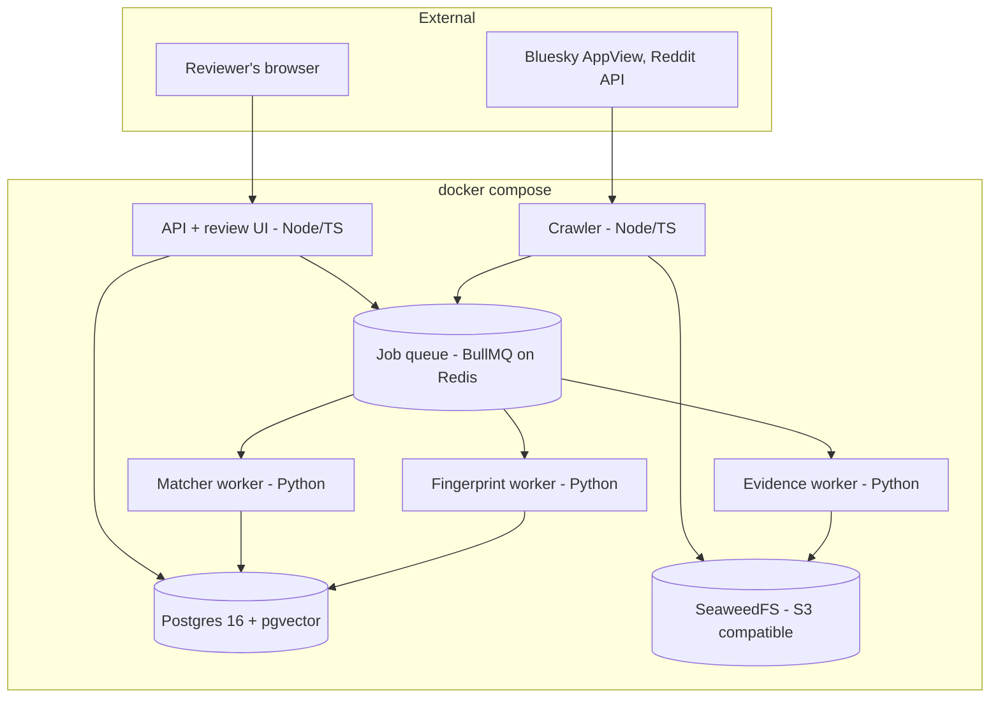
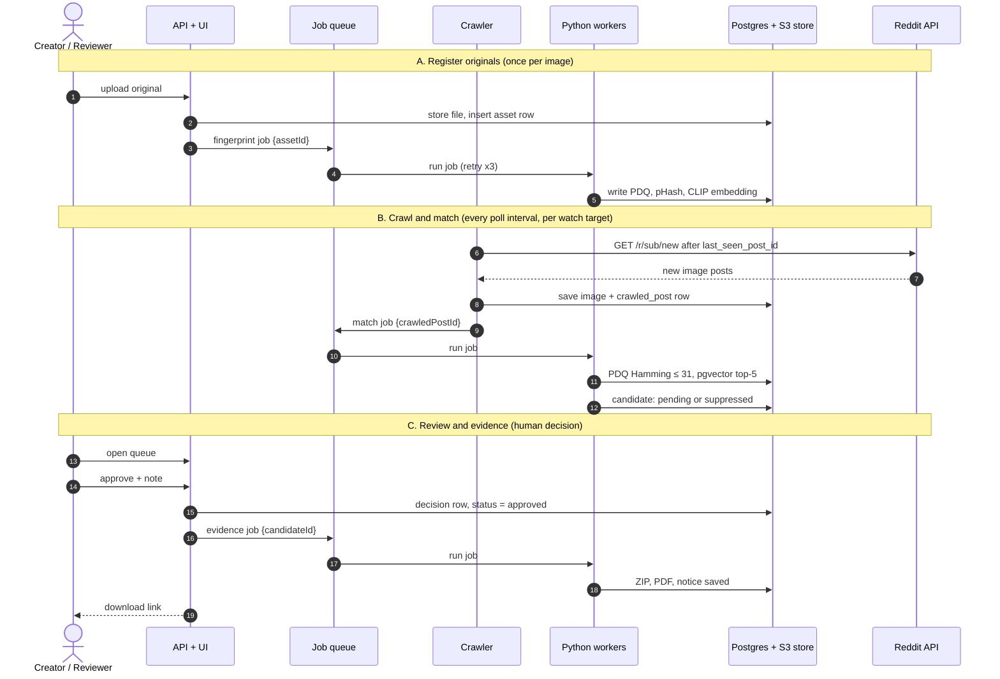
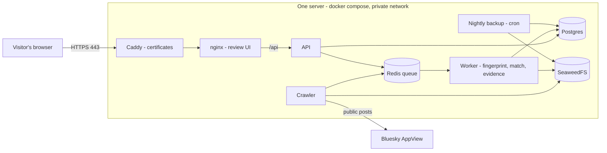

# Repost Radar — Architecture

_As of 2026-11-10 · Shivansh_

Five services, two stores and one external API, joined only by a job queue and Postgres. Companion to [PRD.md](PRD.md).

## Components

| Component | Language | Responsibility |
| --- | --- | --- |
| API + review UI | Node/TypeScript, React | Fastify API: auth, uploads, watch targets, review queue, decisions, downloads; enqueues jobs. `apps/web`: the review UI, served by nginx, which also proxies `/api` so the session cookie stays same-origin |
| Crawler | Node/TypeScript | Polls enabled watch targets, downloads image posts, records them, enqueues match jobs |
| Fingerprint worker | Python | PDQ, pHash and CLIP embedding for a registered original |
| Matcher worker | Python | Fingerprints a crawled image, Hamming + pgvector lookups, writes a scored candidate |
| Evidence worker | Python | Side-by-side PNG, PDF, `metadata.json`, ZIP and notice for an approved candidate |
| Job queue | BullMQ on Redis | Hands jobs to workers with retries; carries ids only, never image data |
| Postgres 16 + pgvector | — | All rows; HNSW index on embeddings; Hamming lookup on PDQ |
| S3 store | — | Originals, crawled images, evidence packs |

## Sequence

The three flows run on different clocks and never call each other; the queue and the stores are all they share.

### Walkthrough

**A. Register originals**

1. The creator uploads an original through the API or CLI.
2. The API writes the file to the S3 store and inserts an `assets` row with its SHA-256; a duplicate is rejected before any work is queued.
3. The API enqueues a `fingerprint` job carrying only the asset id.
4. A Python worker picks it up; BullMQ retries up to three times on failure.
5. The worker normalises the image, computes PDQ, pHash and the CLIP embedding, and upserts them onto the asset row. It then compares the new original with the crawled images still held (within retention) using the same scoring, so a copy crawled before the original was uploaded is still queued.

**B. Crawl and match**

6. The crawler asks Reddit for posts after the stored `last_seen_post_id`; a new target backfills recent posts first.
7. It keeps image and gallery posts and advances `last_seen_post_id` once they are stored.
8. Each image goes to the S3 store with a `crawled_posts` row; a unique `(platform, platform_post_id)` makes re-crawls no-ops.
9. One `match` job per crawled post.
10. A Python worker picks it up.
11. It fingerprints the image and runs PDQ Hamming (≤ 31 is a near-certain copy) and a pgvector top-5 cosine search.
12. It writes `candidates`: `pending` at or above the threshold, `suppressed` below. Posts marked `legitimate` are skipped.

**C. Review and evidence**

13. The reviewer opens the queue sorted by confidence.
14. They approve, dismiss, dismiss-as-legitimate or escalate, with an optional note.
15. The API writes an immutable `decisions` row and updates status — the only code path that can set `approved`.
16. On approve only, the API enqueues an `evidence` job.
17. A worker picks it up.
18. It renders the side-by-side PNG, `metadata.json`, PDF and notice, stores them and inserts `evidence_packs`.
19. The reviewer downloads the pack and files manually. Nothing is ever sent automatically.

## Review API

All routes except `/health`, `/auth/login`, `/auth/signup` and `/auth/options` need a session. With `SIGNUP_ENABLED=true`, `POST /auth/signup` creates a creator, their user (the email is the sign-in name) and their own copy of the default notice templates in one transaction, then signs them in; sign-ups are limited to 10 an hour per visitor address. Failed sign-ins are limited per username (10 per 15 minutes) and per visitor address across usernames (30). The visitor address comes from `X-Forwarded-For`, trusting exactly the proxies in front of the API (`TRUST_PROXY_HOPS`: nginx locally, Caddy and nginx on a live install), so a forged entry is ignored. The operator account (`ADMIN_USERNAME` / `ADMIN_PASSWORD`) is still created when the API starts and is the only one that can read `/metrics`. Every route takes the creator from the session, so another creator's ids answer 404.

| Route | Purpose |
| --- | --- |
| `POST /auth/login`, `POST /auth/logout`, `GET /auth/me` | Session cookie (HTTP-only, SameSite=Strict); only the token's SHA-256 is stored in `sessions` |
| `GET /candidates?status=&platform=&watchTargetId=&postedAfter=&postedBefore=&sort=&pageSize=&pageOffset=` | The queue; defaults to `pending` by confidence |
| `GET /candidates/:id` | One candidate with its `decisions` history |
| `GET /candidates/:id/images/original\|candidate` | Image bytes, streamed from the S3 store behind the session |
| `POST /candidates/:id/decision` | `{action: approve\|dismiss\|legitimate\|escalate, note?, goodFaith?}`; 409 once closed |
| `GET /candidates/:id/pack` | The evidence ZIP; 202 while the worker builds it, 409 with what to fix (e.g. an unresolved placeholder) |
| `POST /candidates/:id/pack` | Rebuild after fixing a template or the profile (replaces notice edits) |
| `GET/PUT /candidates/:id/notice` | The generated notice; edits are saved but may not contain `{{placeholders}}` |
| `GET/POST/PUT/DELETE /notice-templates` | Templates per platform; unknown `{{placeholders}}` are rejected on save |
| `GET /watch-target-suggestions` | Places matched posts point to (crosspost subreddits, hashtags) that you don't watch yet; suggestions only |
| `POST /checks` | "Is this image mine?" for the browser extension: the worker ranks the closest originals; the image is deleted afterwards |
| `GET/POST/DELETE /api-tokens` | Personal access tokens (session only). A token may only check images and read matches |
| `GET/PUT /creator` | Display name plus the legal name, email and address a notice must carry |

**Evidence pack** (`evidence/<candidateId>/pack.zip`): `original.<ext>`, `copy.<ext>`, `side_by_side.png`, `metadata.json` (scores, post details, SHA-256 of both files, the original's proof of ownership by source with `verified: false`, a `timeline` saying whether the copy was posted before the earliest proof, the decision log), `summary.pdf` and `notice.txt`, rendered from the most recently updated template for the copy's platform.

Statuses: `pending` and `escalated` are open; `approved`, `dismissed`, `legitimate` and `removed` are closed (`removed`: the crawler found the copy taken down, recorded as a `system` decision, and deleted the stored copy unless an approved candidate needs it); `suppressed` never reaches the queue. Approving needs the good-faith confirmation and a complete creator profile.

## Platform adapters

The crawler reaches each platform through an adapter registered under the platform's name; see [ADDING_A_PLATFORM.md](ADDING_A_PLATFORM.md).

- **`packages/platforms`** (shared by API and crawler): one `PlatformDefinition` per platform with its target rules (what a valid subreddit, hashtag or account looks like) and its request budget.
- **`apps/crawler/src/platforms/<name>/`**: the adapter. It fetches a newest-first page for a target and maps it to platform-neutral posts (`sourcePostId`, `postedAt`, `permalinkUrl`, `mediaList`).
- **Registry**: `ENABLED_PLATFORMS=reddit,bluesky` decides which adapters start. Each gets its own token bucket. Startup fails on an unknown name, or on a platform with a definition but no adapter.
- **Storage**: `watch_targets.platform` and `crawled_posts.platform` are plain text validated by the registry (migration 004), so a new platform needs no schema change.

Adapters today:

| Platform | Targets | Access | Notes |
| --- | --- | --- | --- |
| Reddit | `r/subreddit` | Live mode needs approved API credentials (self-service closed Nov 2025; this project's request was declined 2026-10-10). Fixture mode uses the local `fake-reddit` service and runs in every CI gate | OAuth client credentials |
| Bluesky | `#hashtag` (searchPosts, newest first) or `@handle` (author's media posts) | No credentials: public AppView; optional app password | Uses `indexedAt` for ordering; skips reposts; skips adult-labelled posts by default |

## Running it

| Mode | How | Who can reach it |
| --- | --- | --- |
| Local | `docker-compose.yml` (README quick start, `scripts/codespace-up.sh`) | You, on `localhost:3000` |
| Codespace demo | `scripts/codespace-demo.sh` adds `docker-compose.demo.yml`: restart after crashes, HTTPS cookies, sign-up off, port 3000 public | Anyone with the `app.github.dev` link, while the Codespace runs |
| Live install | `scripts/server-setup.sh` adds `docker-compose.prod.yml` on one Ubuntu server ([DEPLOYING.md](DEPLOYING.md)) | Anyone, at the server's address over HTTPS |

On a live install only Caddy is published; everything else listens on the private Docker network.

Every long-running service has `restart: unless-stopped`, so a crash or reboot brings it back. The app's recurring work (polling sources, re-checking matches, deleting old crawled images) runs on the crawler's own timer; the nightly backup is the only cron entry. CI runs the whole live setup on an ARM runner (**Deploy smoke (ARM)**) and the demo mode on a clean machine (**Codespace demo**).

## Design decisions

| Decision | Why | Cost |
| --- | --- | --- |
| All cross-service work goes through the queue | A slow model or Reddit outage never blocks the API or UI; workers restart and scale alone | One more container |
| Jobs carry ids, never image data | Safe retries, small queue, worker always reads current state | One extra read per job |
| Every write is idempotent | A crash can redo work but never duplicate it | Unique indexes and upserts |
| Node for API/crawler, Python for ML workers | PDQ, imagehash and open_clip are Python; CRUD and scheduling are fastest in TS | Two toolchains; the queue is the contract |
| Hash first, embedding second | Microsecond exact check gates the slower fuzzy one | Second lookup when the hash misses |
| Human decision between matching and evidence | Wrong notices carry §512(f) liability | Throughput bounded by reviewer time |
| S3-compatible store (SeaweedFS) rather than local disk | S3-compatible; swap to a cloud bucket by config | One more container |
| pgvector rather than a vector DB | One store, one backup, one transaction | Revisit past ~1M vectors |
| One server running the same compose stack, behind Caddy | The live install is the local stack plus an override file, so CI can test it end to end; Caddy gets and renews certificates by itself | One machine to keep up; scaling out means splitting services later |
| Sign-up off on a live install | Password reset and email confirmation aren't built, so accounts come from the operator | Each account is added by hand |

## Data model

| Table | Written in | Important columns |
| --- | --- | --- |
| `creators` | setup | `id`, `name`, `legal_name`, `contact_email`, `mailing_address`, `time_zone`, `own_accounts` text[] (`platform:handle`; a match on one is the creator's own post and cannot be approved), `created_at` |
| `assets` | A2, A5 | `id`, `creator_id`, `sha256` (unique), `storage_key`, `width`, `height`, `phash` bit(64), `pdq` bit(256), `embedding` vector(512), `fingerprinted_at`; proof of ownership: `first_published_url`, `first_published_on`, `ownership_note` (stated by the creator) and `exif_taken_at`, `exif_artist`, `exif_copyright` (read from the file by the worker). None of it is verified. |
| `watch_targets` | setup, B7 | `id`, `creator_id`, `platform`, `target_name`, `poll_interval_s`, `last_seen_post_id`, `enabled`, `deleted_at` |
| `crawled_posts` | B8, B11 | `id`, `watch_target_id`, `creator_id` (whose source found it; unique per `creator_id, platform, platform_post_id`, so two creators watching one account each hold and match their own copy, stored under `crawled/<creatorId>/…`), `platform`, `platform_post_id`, `source_post_id`, `author`, `url`, `posted_at`, `storage_key`, `phash`, `pdq`, `embedding`, `is_legitimate`, `crawled_at` |
| `candidates` | B12, C15 | `id`, `asset_id`, `crawled_post_id`, `hash_distance`, `embed_similarity`, `confidence`, `status`, `created_at` |
| `decisions` | C15 | `id`, `candidate_id`, `actor`, `from_status`, `to_status`, `note`, `decided_at` |
| `evidence_packs` | C18 | `id`, `candidate_id`, `zip_key`, `pdf_key`, `notice_text`, `template_id`, `generated_at` |
| `notice_templates` | setup | `id`, `creator_id` (the owner; rows with none are the pristine defaults copied at sign-up and never served by the API), `platform`, `name`, `subject`, `body`, `updated_at` |
| `eval_labels` | eval | `asset_id`, `probe_storage_key`, `transform`, `is_match` |

Indexes: HNSW on `assets.embedding` (cosine); unique `(platform, platform_post_id)` on `crawled_posts`; `(status, confidence desc)` on `candidates`. Hamming search on `pdq` uses `bit_count(pdq # $1)`; at portfolio scale (≤ 10k assets) a sequential scan is fast enough.
