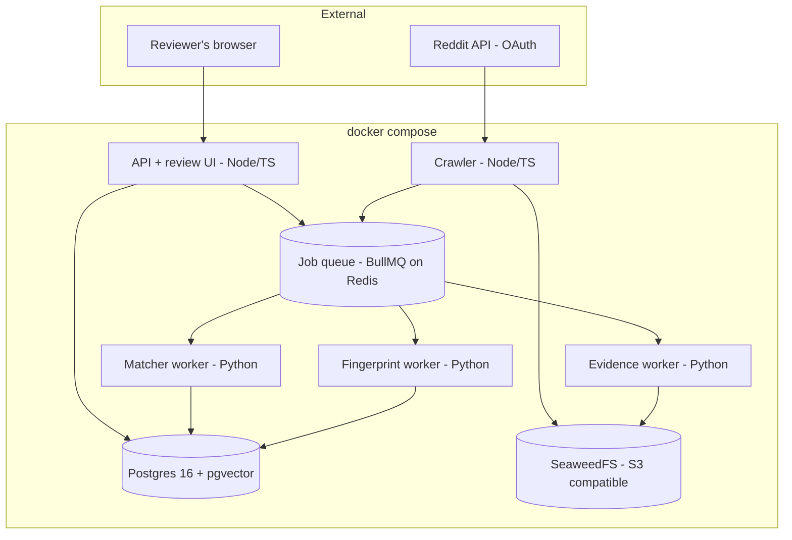
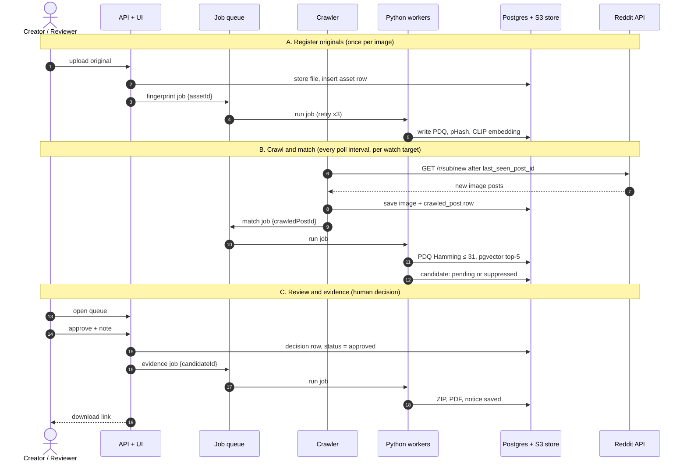

# Repost Radar — Architecture

_As of 2026-10-10 · Shivansh_

Five services, two stores and one external API, joined only by a job queue and Postgres. Companion to [PRD.md](PRD.md).

## Components

| Component | Language | Responsibility |
| --- | --- | --- |
| API + review UI | Node/TypeScript | Auth, uploads, watch targets, review queue, decisions, downloads; enqueues jobs |
| Crawler | Node/TypeScript | Polls enabled watch targets, downloads image posts, records them, enqueues match jobs |
| Fingerprint worker | Python | PDQ, pHash and CLIP embedding for a registered original |
| Matcher worker | Python | Fingerprints a crawled image, Hamming + pgvector lookups, writes a scored candidate |
| Evidence worker | Python | Side-by-side PNG, PDF, `metadata.json`, ZIP and notice for an approved candidate |
| Job queue | BullMQ on Redis | Hands jobs to workers with retries; carries ids only, never image data |
| Postgres 16 + pgvector | — | All rows; HNSW index on embeddings; Hamming lookup on PDQ |
| S3 store | — | Originals, crawled images, evidence packs |

## Sequence

The three flows run on different clocks and never call each other; the queue and the stores are all they share.

### Walkthrough

**A. Register originals**

1. The creator uploads an original through the API or CLI.
2. The API writes the file to the S3 store and inserts an `assets` row with its SHA-256; a duplicate is rejected before any work is queued.
3. The API enqueues a `fingerprint` job carrying only the asset id.
4. A Python worker picks it up; BullMQ retries up to three times on failure.
5. The worker normalises the image, computes PDQ, pHash and the CLIP embedding, and upserts them onto the asset row.

**B. Crawl and match**

6. The crawler asks Reddit for posts after the stored `last_seen_post_id`; a new target backfills recent posts first.
7. It keeps image and gallery posts and advances `last_seen_post_id` once they are stored.
8. Each image goes to the S3 store with a `crawled_posts` row; a unique `(platform, platform_post_id)` makes re-crawls no-ops.
9. One `match` job per crawled post.
10. A Python worker picks it up.
11. It fingerprints the image and runs PDQ Hamming (≤ 31 is a near-certain copy) and a pgvector top-5 cosine search.
12. It writes `candidates`: `pending` at or above the threshold, `suppressed` below. Posts marked `legitimate` are skipped.

**C. Review and evidence**

13. The reviewer opens the queue sorted by confidence.
14. They approve, dismiss, dismiss-as-legitimate or escalate, with an optional note.
15. The API writes an immutable `decisions` row and updates status — the only code path that can set `approved`.
16. On approve only, the API enqueues an `evidence` job.
17. A worker picks it up.
18. It renders the side-by-side PNG, `metadata.json`, PDF and notice, stores them and inserts `evidence_packs`.
19. The reviewer downloads the pack and files manually. Nothing is ever sent automatically.

## Design decisions

| Decision | Why | Cost |
| --- | --- | --- |
| All cross-service work goes through the queue | A slow model or Reddit outage never blocks the API or UI; workers restart and scale alone | One more container |
| Jobs carry ids, never image data | Safe retries, small queue, worker always reads current state | One extra read per job |
| Every write is idempotent | A crash can redo work but never duplicate it | Unique indexes and upserts |
| Node for API/crawler, Python for ML workers | PDQ, imagehash and open_clip are Python; CRUD and scheduling are fastest in TS | Two toolchains; the queue is the contract |
| Hash first, embedding second | Microsecond exact check gates the slower fuzzy one | Second lookup when the hash misses |
| Human decision between matching and evidence | Wrong notices carry §512(f) liability | Throughput bounded by reviewer time |
| S3-compatible store (SeaweedFS) rather than local disk | S3-compatible; swap to a cloud bucket by config | One more container |
| pgvector rather than a vector DB | One store, one backup, one transaction | Revisit past ~1M vectors |

## Data model

| Table | Written in | Important columns |
| --- | --- | --- |
| `creators` | setup | `id`, `name`, `contact_email`, `created_at` |
| `assets` | A2, A5 | `id`, `creator_id`, `sha256` (unique), `storage_key`, `width`, `height`, `phash` bit(64), `pdq` bit(256), `embedding` vector(512), `fingerprinted_at` |
| `watch_targets` | setup, B7 | `id`, `creator_id`, `platform`, `subreddit`, `poll_interval_s`, `last_seen_post_id`, `enabled`, `deleted_at` |
| `crawled_posts` | B8, B11 | `id`, `watch_target_id`, `platform_post_id`, `author`, `url`, `posted_at`, `storage_key`, `phash`, `pdq`, `embedding`, `is_legitimate`, `crawled_at` |
| `candidates` | B12, C15 | `id`, `asset_id`, `crawled_post_id`, `hash_distance`, `embed_similarity`, `confidence`, `status`, `created_at` |
| `decisions` | C15 | `id`, `candidate_id`, `actor`, `from_status`, `to_status`, `note`, `decided_at` |
| `evidence_packs` | C18 | `id`, `candidate_id`, `zip_key`, `pdf_key`, `notice_text`, `template_id`, `generated_at` |
| `notice_templates` | setup | `id`, `platform`, `name`, `subject`, `body`, `updated_at` |
| `eval_labels` | eval | `asset_id`, `probe_storage_key`, `transform`, `is_match` |

Indexes: HNSW on `assets.embedding` (cosine); unique `(platform, platform_post_id)` on `crawled_posts`; `(status, confidence desc)` on `candidates`. Hamming search on `pdq` uses `bit_count(pdq # $1)`; at portfolio scale (≤ 10k assets) a sequential scan is fast enough.
