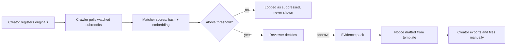

# Repost Radar — PRD

_As of 2026-10-10 · Shivansh_

## Overview

Repost Radar finds where a creator's images have been re-uploaded on Reddit, even after cropping, re-encoding, filtering or screenshotting, and hands each match to a human reviewer with an evidence pack and a draft DMCA notice. Nothing is sent to any platform without a reviewer's approval.

**Problem.** Creators lose revenue and control when their work is reposted without permission. Finding copies by hand means scrolling platforms daily; filing a wrong notice carries legal liability (17 U.S.C. §512(f)). Paid services (Rulta, BranditScan, Red Points) solve this behind closed doors; nothing open-source covers the pipeline end to end.

**Why now.** The building blocks are mature and free: perceptual hashing (Meta's PDQ, pHash), CLIP embeddings with pgvector, and a documented Reddit API. The remaining work is the pipeline and the review workflow.

**Platform update (2026-10-10).** Reddit closed self-service Data API keys in Nov 2025 and declined this project's access request, so Bluesky (public AppView, no approval) became the live platform. The Reddit adapter remains and is tested against a fixture feed; the Reddit-specific acceptance criteria below were met there.

**Scope of v1.** One platform (Reddit), one media type (images), one detection bank per creator, one reviewer role. Built solo, a few hours a week, as a portfolio project; the README and evaluation table are first-class deliverables.

## Goals and non-goals

**Goals (v1 must)**

1. Detect re-uploads of registered images on watched subreddits, including copies that were cropped, flipped, re-encoded, filtered, screenshotted or overlaid with meme text.
2. Give every candidate a confidence score with the two signals behind it (hash distance, embedding similarity) so a reviewer can judge it in seconds.
3. Keep a human in the loop: no notice leaves the system without an explicit approve action, and every decision is logged.
4. Produce an evidence pack per match (side-by-side images, post URL, author, timestamp, scores) and a pre-filled DMCA draft from a template.
5. Publish a precision/recall table from a labelled test set, reproducible with one command.
6. Run end to end with `docker compose up` on a laptop.

**Non-goals (v1 will not)**

- Submit notices to any platform automatically. No platform offers a clean API for it and this is where the legal risk sits; v1 stops at approve + export.
- Cover more than one platform or more than images. Video (vPDQ/TMK) and a second platform are stretch items.
- Detect deepfakes or likeness misuse.
- Offer multi-tenant SaaS features: billing, plans, team roles, email notifications. (What a hosted version would need to stop false claims is written up under [Future: a hosted service's trust and safety](#future-a-hosted-services-trust-and-safety-not-built).)
- Replace legal advice. The draft notice is a starting point the creator is responsible for.

## Users

| Role | Who | What they need | How v1 serves them |
| --- | --- | --- | --- |
| Creator | A photographer, illustrator or small brand with 20–500 original images | Know within a day when a copy appears; spend minutes, not hours, on each one | Uploads originals once; sees matches with scores and evidence; approves or dismisses |
| Reviewer | The same person in v1; later an assistant or agency staff | Decide fast and safely whether a match is a real infringement | Side-by-side view, both scores, post context, one-click actions, full audit log |
| Portfolio reader | A hiring manager or engineer skimming the repo | Understand the design in 5 minutes and trust it works | README with diagrams, evaluation table, demo GIF, `docker compose up` |

In v1 the creator is also the reviewer. The data model keeps the two roles separate so an agency can review for several creators later.

## Core flow

**User stories**

- As a creator, I upload a folder of originals once and the system fingerprints them within a minute.
- As a creator, I name the subreddits to watch and a poll interval, and can add more later.
- As a reviewer, I open a queue sorted by confidence and see original and candidate side by side with both scores, so I can decide in under 30 seconds.
- As a reviewer, I approve, dismiss, dismiss-as-legitimate or escalate with an optional note; every decision is timestamped and attributed.
- As a creator, I download an evidence pack (ZIP: both images, side-by-side PNG, metadata JSON, PDF summary) and a pre-filled notice for an approved match.
- As a reviewer, I mark a match as legitimate reuse so the same post never surfaces again.
- As a portfolio reader, I run one command and see the test set scored.

### Review actions

| Action | Use when | Result |
| --- | --- | --- |
| Approve | It is my work, reposted without permission | Status `approved`; evidence pack + notice generated. The only path to a notice |
| Dismiss | Not a copy; the matcher was wrong | Status `dismissed`; the same post may still surface against a different original |
| Dismiss as legitimate | It is my work, but the reuse is allowed | Status `legitimate`; the post is suppressed permanently against every original |
| Escalate | Unsure (heavy crop, derivative, fair-use question) | Status `escalated`; moved to a second-look list |

Every action accepts an optional note, stored with actor, time and previous status in the `decisions` audit table.

## Functional requirements

| Module | Requirement | Priority |
| --- | --- | --- |
| Ingestion | Accept JPEG/PNG/WebP up to 20 MB via API or CLI; store in object storage (S3 store); reject duplicates by SHA-256 | Must |
| Ingestion | Normalise to RGB, max 1024 px long edge, before fingerprinting; keep the original untouched | Must |
| Fingerprinting | Compute pHash (64-bit), PDQ (256-bit) and a CLIP ViT-B/32 embedding (512-d); store all three with the asset | Must |
| Fingerprinting | Idempotent: re-running on the same asset produces no new rows | Must |
| Watch targets | Creator adds, pauses, resumes, removes subreddits at runtime; a new target backfills up to 1,000 posts or 7 days on first crawl | Must |
| Crawler | Poll enabled targets via the official Reddit API (OAuth, `new` listing); resume from `last_seen_post_id` per target | Must |
| Crawler | Global rate budget (≤ 60 req/min) shared across targets, exponential backoff; log every request; store only title, author, URL, timestamp | Must |
| Crawler | Image and gallery posts only; skip video, link, text posts; cap 5 MB per image | Must |
| Matcher | Hash lookup (Hamming ≤ threshold) over the creator's bank, then pgvector cosine search (top-5) | Must |
| Matcher | One confidence score 0–1 from a documented formula; store both raw signals beside it | Must |
| Matcher | Below threshold: `suppressed` (kept for evaluation); above: `pending` in the review queue | Must |
| Review queue | List by confidence; filter by status, subreddit, date; side-by-side view with scores and post metadata | Must |
| Review queue | Four actions with optional note; immutable audit row per action | Must |
| Evidence pack | On approve: ZIP with original, candidate, side-by-side PNG, `metadata.json`, one-page PDF | Must |
| Notice draft | Fill a per-platform template (Reddit v1); creator edits before export | Must |
| Notice draft | Template editor with `{{placeholders}}`; every placeholder must resolve before export | Should |
| Evaluation | `make eval` prints precision, recall and F1 at the configured thresholds | Must |
| Auth | Single admin login; no public routes except `/health` | Must |
| Observability | Structured JSON logs; `/metrics` with crawl rate, queue depth, match counts | Should |

## Detection approach

Two detectors run in sequence because they fail differently: a hash is cheap and exact on near-copies but blind to heavy edits; an embedding survives edits but costs more and can confuse similar-looking originals.

| Signal | Catches | Misses | Cost per image |
| --- | --- | --- | --- |
| pHash (64-bit, DCT) | Re-encode, resize, mild compression, small watermark | Crop > 15%, flip, heavy filter, text overlay | ~5 ms, no model |
| PDQ (256-bit, Meta) | As pHash, more robust to crop and rotation | Flip (needs dihedral variants), semantic edits | ~10 ms, no model |
| CLIP ViT-B/32 (512-d) | Crop, flip, filter, screenshot, meme overlay, colour grade | Different photos of the same scene (false-positive risk) | ~40 ms CPU |

**Scoring.** `hash_score = 1 − hamming/256` on PDQ; `embed_score` = CLIP cosine similarity. Confidence = `hash_score` if PDQ distance ≤ 31, else `0.6 × embed_score + 0.4 × hash_score`. Review threshold: **0.70** (`REVIEW_THRESHOLD`), chosen in phase 3. The first guess of 0.80 found only 60% of edited copies; 0.70 gives precision 0.964 and recall 0.963 on the evaluation set ([tuning notes](notes/phase3-tuning.md)). Scores between 0.60 and 0.70 are stored as `suppressed`.

**Evaluation set.** 200 CC0 originals × 8 transforms (resize 50%, JPEG q=40, crop 20%, horizontal flip, filter, phone screenshot, meme caption, 10° rotation) = 1,600 positives; 2,000 unrelated negatives from the same subreddits.

| Target | v1 bar |
| --- | --- |
| Precision at review threshold | ≥ 0.95 |
| Recall overall | ≥ 0.90; ≥ 0.98 on resize/re-encode |
| Recall on crop 20% + meme overlay | ≥ 0.80 (reported honestly if lower) |
| Matcher latency per crawled image | ≤ 200 ms p95 on CPU |

## Non-functional requirements

| Area | Requirement |
| --- | --- |
| Performance | Fingerprint ≤ 2 s on CPU; score ≤ 200 ms p95; queue page ≤ 500 ms at 10,000 candidates |
| Reliability | Every job idempotent, retried 3× with backoff; crashed worker loses nothing; crawler resumes after restart |
| Retention | Unmatched crawled images deleted after 7 days; matched kept until closed + 90 days |
| Security | Argon2 password hash, HTTP-only session cookie; secrets server-side only; all routes but `/health` authenticated |
| Privacy | Store only id, author handle, URL, timestamp, image. No comments, profiles or cross-platform profiling |
| Legal guardrail | Notice only for `approved`; approve screen shows a §512(f) warning and a required good-faith checkbox |
| Ethical guardrail | Crawl only creator-named subreddits; no site-wide sweeps |
| Platform terms | Official Reddit API only, registered app, descriptive user agent, honour rate limits |
| Portability | `docker compose up`, `make seed`, `make eval`; no cloud account needed |

## Acceptance criteria

- [x] `docker compose up` + `make seed` gives a working app with 20 demo originals in under 5 minutes. _(phase 1 gate: seed in ~8 s after the stack is up)_
- [x] 5 transformed copies posted to a private test subreddit all appear in the queue within one poll interval; no other original produces a candidate. _(phase 2 gate, against a fixture subreddit until Reddit API access is granted)_
- [x] `make eval` prints precision ≥ 0.95 and recall ≥ 0.90, matching the README. _(held-out 0.962 / 0.966)_
- [x] Approving a candidate produces the full evidence ZIP and a notice with every placeholder resolved. _(gate4 steps 7–8e)_
- [x] Killing any worker mid-job loses no candidate and creates no duplicate. _(gate4 resilience: worker killed with an approval queued, API restarted)_
- [x] A dismiss-as-legitimate post never re-enters the queue, even after a crawler restart. _(gate4 resilience step R4)_

## Phases

| Phase | Delivers | Gate |
| --- | --- | --- |
| 0. Scaffold | Every container up and healthy | Ping job reaches the Python worker |
| 1. Fingerprint | Upload → 3 fingerprints; `is-copy A B` CLI | Resize ≥ 0.95, unrelated ≤ 0.60 |
| 2. Crawl | Reddit poller, watch targets, matcher | 5 planted copies found; 1 h soak, no backlog |
| 3. Evaluate | Labelled set, `make eval`, tuned thresholds | P ≥ 0.95, R ≥ 0.90 reproducible |
| 4. Review | Login, queue UI, decisions, evidence, notice | All acceptance criteria pass |
| 5. Stretch | README/GIF, Chrome extension, discovery, video | — |

## Future: a hosted service's trust and safety (not built)

_Written 2026-10-18. Not planned for v1; recorded so the self-hosted design doesn't close the door on it._

**Why self-hosted can't stop a determined false claim.** Each install belongs to one creator, who owns the server and the MIT-licensed code: any check can be deleted, and a notice is only text. So v1 aims to catch honest mistakes and make a false claim uncomfortable and accountable: the §512(f) warning and good-faith statement, the append-only decision log, proof of ownership labelled by source, the "posted before your proof" and "file names someone else" warnings, own-account blocking, and a timeline in every evidence pack. Stopping a false claimant falls to the platform that receives the notice, the counter-notification process (§512(g)) and liability for knowing misrepresentation (§512(f)) ([17 U.S.C. §512](https://www.law.cornell.edu/uscode/text/17/512)).

**What changes if Repost Radar is ever hosted.** The operator is no longer the claimant, so blocking becomes possible, and it becomes necessary: notices sent at scale through one service put that service's reputation, and every honest creator's notices, at risk.

| Threat | Example |
| --- | --- |
| False ownership | Registers another photographer's image and files against the real author |
| Harassment | Mass notices against one account or community |
| Competitor takedowns | Targets a rival seller's listings with plausible-looking claims |
| Fair-use suppression | Files against commentary, criticism or parody |
| Impersonation | Claims to be the rights holder's agent without authority |
| Account takeover | Someone else signs in to an honest creator's account |

**Controls, in layers**

1. **Identity before notices unlock.** A verified email and a verified legal identity, through an identity-verification provider (chosen later), that matches the legal name on notices. An agent filing for someone else uploads written authorisation, since a notice must state the sender is authorised to act for the owner (§512(c)(3)(A)(vi)).
2. **Ownership verified per original, not just stated.** Each original carries a proof level the service checks itself:
   - *Self-stated*: what v1 records today.
   - *Linked account*: the creator connects the account that published it, through the platform's sign-in, and the earliest post is fetched from that account.
   - *Archived*: the first-published URL has a Wayback Machine snapshot from on or before the stated date, using its [availability API](https://archive.org/help/wayback_api.php).
   - *Content Credentials*: a valid [C2PA](https://c2pa.org/) manifest naming the creator.
   Notices for originals below a set level are held.
3. **Risk score on every approval.** Inputs v1 already computes: copy older than the earliest proof, file Artist not the claimant, own-account matches. New inputs: many different targets in a short window, a new account, earlier counter-notices against this claimant, low match confidence. Low risk passes; medium adds a confirmation and a required note; high is held for human review.
4. **Human trust and safety review** for held claims, with a time limit, seeing the same side-by-side, proof and timeline the creator saw, and able to ask for more evidence.
5. **Consequences.** Record counter-notices and their outcome per claimant; strikes, then suspension, for claims that turn out false; a public form where a person who received a notice can report abuse.
6. **Limits.** Notices per day per account, starting low for new accounts and rising with a clean record.
7. **Account security.** Two-factor sign-in for anyone who can approve; new-device alerts.

**What v1 already provides for this.** The approval gate and good-faith statement; the append-only `decisions` log with actor and note; proof of ownership by source, with `verified: false`; the claim warnings and own-account block; and `metadata.json`'s `timeline`, which records when a claim was approved despite a "posted before your proof" warning.

**Open questions**

- [ ] File notices for creators (as their agent) or keep "the creator files"? Filing for them raises the service's own exposure.
- [ ] Identity-verification provider, cost per creator, and what to do for creators who can't verify.
- [ ] Rules outside the US. For example, the EU's Digital Services Act has its own notice-and-action article (Article 16); not yet reviewed against the official text, so unverified.
- [ ] Where risk thresholds sit, and how to measure false holds against honest creators.

## References

| Project | Use it for |
| --- | --- |
| [facebook/ThreatExchange](https://github.com/facebook/ThreatExchange) | PDQ / vPDQ; hasher → matcher → actioner design |
| [JohannesBuchner/imagehash](https://github.com/JohannesBuchner/imagehash) | pHash |
| [rom1504/clip-retrieval](https://github.com/rom1504/clip-retrieval) | CLIP embedding pipeline patterns |
| [NKS01X/Krypton](https://github.com/NKS01X/Krypton) | End-to-end pHash + CLIP + pgvector example |
| [roostorg/coop](https://github.com/roostorg/coop) | Review-queue patterns |
| [Automattic/legalmattic](https://github.com/Automattic/legalmattic) | DMCA notice templates |
| [anthropics/claude-for-legal](https://github.com/anthropics/claude-for-legal) | Fair-use and §512(f) gates for the approve screen |

## Open questions

- [x] Public repo from day one, or private until phase 3's numbers are in? _(private until v1 was feature-complete; public since 2026-10-10)_
- [x] Demo content: own photos, or a CC0 set so the repo can ship the eval set? _(decided: CC0 from Wikimedia Commons)_
- [x] CPU-only CLIP, or an optional GPU path for faster eval runs? _(decided: CPU-only; eval fingerprints are cached, so re-runs take minutes)_
